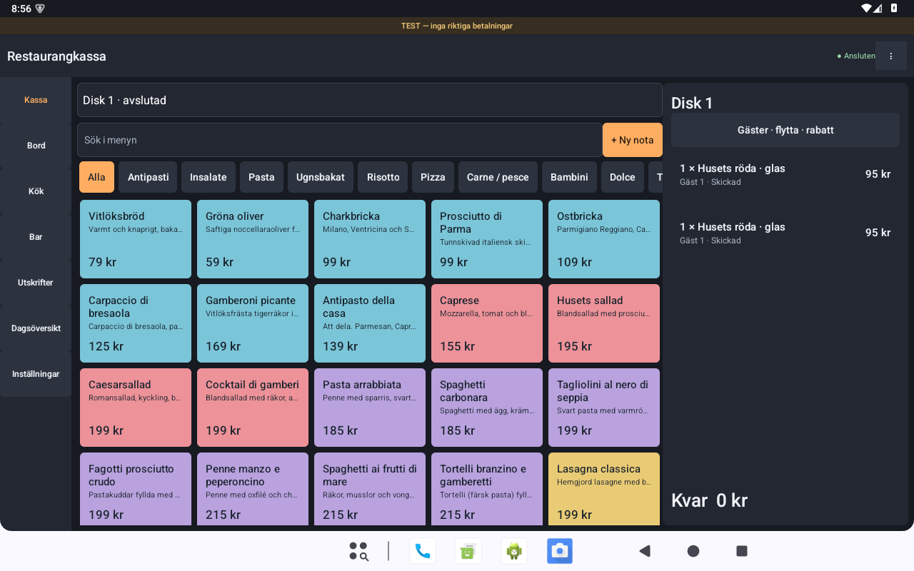

# Restaurangkassa Native

Separat Android-app med vanliga Android-vyer och RecyclerView. Inget WebView, ingen React och ingen HTML/JavaScript körs i appen. Det mörka, neutrala temat har grafitgrå bakgrund, orange accent och färgade artikelrutor. Företag, meny, priser och behörigheter kommer från kassaservern.

**Träningsversion.** Betalningar, kontrollösning och utskrift använder fortfarande serverns testadaptrar. Denna version tar inte riktiga betalningar och är inte en godkänd kassaregisterprodukt.

## Separering

- All Android-kod, resurser, Gradle-konfiguration och tester ligger i `android-native/`.
- Native-testappen har app-id `se.restaurant.nativepos.test`. Den kan installeras bredvid den tidigare appen `se.restaurant.pos.test` och har egna inställningar, inloggning och sparade försök.
- Release-varianten har app-id `se.restaurant.nativepos`. Egen produktionssignering krävs senare.
- Webbklient, server, befintligt Android-projekt och tidigare APK ändras inte av detta projekt eller dess byggskript.
- Apparna använder samma server-API. Om två appar ansluts till samma server arbetar de med samma serverdata. Använd en separat träningsdatabas under provningen.
- Grenen `codex/android-native` utgår från `7061d4a1011e67ae85ad86d7e4ee2f31795da5a8c`. Ingenting behöver slås ihop med `main` för att bygga native-appen.

## Det som finns

Native inloggning och PIN-knappsats; handkassa och huvudkassa; meny, sökning och kategorier; bord och disknotor; gäster, tillval, köksmeddelanden, väntande rätter och utslag; prisändring, rabatt, flytt och makulering; köks- och barbongar; delbetalning per belopp, gäst, lika delar, rader eller antal; simulerat kort, Swish och kontant; dricks och returer; kvitton, kontroll av osäkra utfall och utskriftskö; öppning, kontantrörelser och dagsavslut; journal och rapportexport; företag, meny, tillval, personal, bord, enheter och skrivare.

Bord visas som en snabb lista. Köket hanterar hela bongens status. Webbversionens grafiska bordsplan och eventuella senare funktioner för stationsindelning/beredning per artikel är inte kopierade. Servern är fortfarande källa för moms, betalningsfördelning, journal och kontrollkoder. Alla administrativa funktioner och hårdvarukombinationer behöver restaurangens acceptanstest före pilot.

## Installera på Samsung eller emulator

1. Bygg eller hämta `Restaurangkassa-native-test.apk`. GitHub Actions publicerar också `app-optimized.apk` i artefakten **restaurangkassa-native-test** för denna gren.
2. Öppna APK-filen på Samsung och tillåt installation från den app som öppnar filen. På en utvecklingsenhet kan du i stället köra `adb install -r Restaurangkassa-native-test.apk`.
3. Appen heter **Restaurangkassa Native**. Ange kassaserverns adress och den enhetskod som hör till testinstallationen. Ange sedan personalens test-PIN.
4. Samsung behöver nå servern över samma nätverk eller en säker tunnel. Datorns `localhost` är inte telefonens adress. I Android Studios emulator når `10.0.2.2` värddatorn.

Android 8.0/API 26 eller senare krävs. Appen stöder ARM, ARM64 och x86 utan egen processorberoende native-kod. APK-installation på Samsung innebär inte att en låst betalterminal accepterar installationen; detta avgör leverantörens terminalmodell, signering och distributionssystem.

Testbyggen tillåter HTTP enbart för uttryckliga lokala IP-adresser. Release kräver HTTPS. TLS-fel kringgås inte; installera rätt betrodd CA för en privat server. Den gamla serverns första träningskod kan vara `LAGUSTOSA-TEST`, medan neutralare installationer använder `KASSA-TEST`. Använd den kod som faktiskt är konfigurerad på er server.

## Bygg

JDK 17 eller 21, Android SDK Platform 35 och internet för Gradles låsta beroenden behövs. Projektets wrapper använder Gradle 8.11.1 med SHA-256-kontroll. Ingen Node-/webbbyggning behövs för själva APK:n.

Windows, från repots rot:

```powershell
$env:JAVA_HOME = 'sökväg till JDK 17 eller 21'
$env:ANDROID_HOME = 'sökväg till Android SDK'
powershell -NoProfile -ExecutionPolicy Bypass -File android-native\scripts\build.ps1
```

Skriptet bygger R8-optimerad test-APK, kör JVM-tester och Android Lint. Resultatet skrivs endast till `android-native/releases/Restaurangkassa-native-test.apk`. Om SDK/JDK redan finns i projektets tidigare lokala byggmiljö används de som reservsökvägar. `-DebugBuild` bygger en större utvecklingsvariant. `-Instrumented` bygger även Android-testerna. `-Release` ger en optimerad **osignerad** HTTPS-APK; distribuera inte den som färdig produktionsapp.

På macOS/Linux, från `android-native/`:

```sh
./gradlew :app:assembleOptimized :app:testDebugUnitTest :app:lintDebug
```

Test-APK signeras med datorns Android-debugnyckel. Två utvecklingsdatorer eller CI kan ha olika nycklar. Behåll samma nyckel under en pilot. Avinstallera inte en installation med ett osäkert sparat försök bara för att byta signering.

## Prestanda

Målet är att minst 95 % av uppmätta bilder under aktiv scrollning/arbetsflöden tar högst 33,3 ms på vald fysisk handkassa, gärna högst 16,7 ms. Det motsvarar bildbudgetarna för 30 respektive 60 fps. Idle-tid räknas inte som ett FPS-resultat och appen är inte låst till 30 fps.

- Bara synliga artikel- och orderrader skapas. Även artikelurval vid delbetalning/retur återanvänder rader.
- Sökning, listjämförelser, nätverk, JSON, summering och beständig lagring görs på bakgrundstrådar.
- Serverhändelser slås samman till en uppdatering; bakgrundsläge stänger händelseströmmen och pausar kontroller.
- Stabil meny behåller samma produktmodeller. Inga bakgrundsanimationer, oskärpa, stora bilder eller webbmotorer.
- R8 och resurskrympning används i APK:n som distribueras för provning.

Välj **⋮ → Mät prestanda**, kör realistiska arbetsmoment och välj sedan **Spara prestandamätning**. Mätningen använder Android HWUI `TOTAL_DURATION`, med första ritningen borttagen och redovisning av tappade mätvärden. Testbygget skriver även en diagnostikfil när appen läggs i bakgrunden. Den innehåller bildtider och enhetsmodell, inga order- eller personuppgifter.

Se [verifiering och terminalprov](VERIFICATION.md). Emulatorresultat är utvecklingsindikatorer och bevisar inte stabila 30/60 fps på Worldline eller Swedbank Pay.

Skärmbilder från den verkliga optimerade APK:n, med isolerade träningsdata:



[Visa native handkassa](docs/native-handheld.png) · [Visa träningsbetalningen](docs/native-payment.png)

## Säkra försök och anslutning

En skrivning sparas beständigt på enheten **innan** den skickas. Om svaret förloras återanvänds samma nyckel och innehåll efter omstart. Ett osäkert försök låser nya ändringar tills det har kontrollerats. Försöket är bundet till ursprunglig server, personal, enhet och eventuell testomgång. Utskrifter, kopior och åtgärder som kan byta enhetskod återspelas inte automatiskt.

Detta är inte ett offline-kassaregister. Utan serverkontakt spärras nya registreringar. Radera inte appdata eller avinstallera när ett försök fortfarande behöver kontrolleras.

## Innan riktig terminaldrift

Välj exakt terminalmodell och få leverantörens SDK-/integrationsbesked, testa på fysisk hårdvara, anslut godkända betal- och kontrolladaptrar på servern, verifiera kvitton/skrivare och avbrottsfall, slutför kassaregisterkrav och produktionssignering/distribution. Native-gränssnittet i sig ger varken betalningsgodkännande eller juridiskt godkännande.
