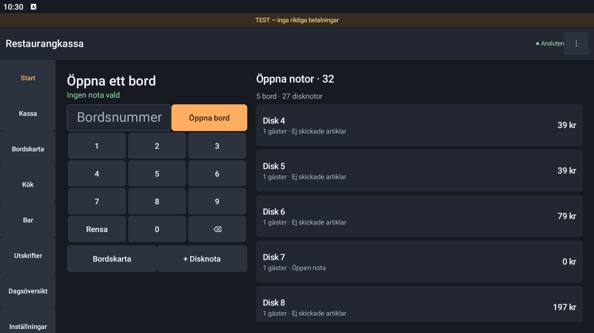

# Restaurangkassa Native

Separat Android-app med vanliga Android-vyer och RecyclerView. Inget WebView, ingen React och ingen HTML/JavaScript körs i appen. Det mörka, neutrala temat har grafitgrå bakgrund, orange accent och färgade artikelrutor. Företag, meny, priser och behörigheter kommer från kassaservern.

**Träningsversion.** Betalningar, kontrollösning och utskrift använder fortfarande serverns testadaptrar. Denna version tar inte riktiga betalningar och är inte en godkänd kassaregisterprodukt.

Version **1.1.1** rättar samtidiga ändringar på samma nota, köksbongarnas tillval/makuleringar och dialoger vid utgången inloggning. **Dela nota** finns bredvid **Ta betalt** och öppnar delningsvalet direkt. Där finns lika delar, delbelopp, per gäst, valda rader och antal per artikel. Ange hur många delar som återstår vid varje betalning. Automatisk skickning till kök/bar är ännu inte aktiverad; **Skicka till kök & bar** och **Slå ut väntande rätter** används fortfarande.

Om en annan enhet ändrar notan mellan visning och bekräftelse avvisas den gamla ändringen. Kontrollera den uppdaterade notan, avsluta det avvisade försöket och gör vid behov ett nytt. Appen byter inte längre version i bakgrunden och upprepar en gammal ändring. Vid ett förlorat svar används fortfarande samma sparade nyckel och samma avsikt. Efter ett bekräftat anrop hämtas den nya notan innan nästa ändring aktiveras.

Kök och bar visar tillval och köksmeddelanden i både listan och bongens detaljvy. Makulerade artikelrader visas inte som kvarvarande arbete; en helt makulerad originalbong döljs medan dess annulleringsbong finns kvar. Statusknappen följer nästa tillåtna steg. Annulleringsbongar visar också orsaken och har egna knapptexter för hantering.

## Separering

- All Android-kod, resurser, Gradle-konfiguration och tester ligger i `android-native/`.
- Native-testappen har app-id `se.restaurant.nativepos.test`. Den kan installeras bredvid den tidigare appen `se.restaurant.pos.test` och har egna inställningar, inloggning och sparade försök.
- Release-varianten har app-id `se.restaurant.nativepos`. Egen produktionssignering krävs senare.
- Webbklient, den ordinarie serverns källfiler, befintligt Android-projekt och tidigare APK ändras inte av detta projekt eller dess byggskript.
- `android-native/server/` är en separat serverstart som återanvänder grund-API:t och lägger till en atomisk minskning av artikelantal. Den ordinarie webbservern registrerar inte denna extra route. Använd en egen native-träningsdatabas och port.
- Om två appar ansluts till samma server arbetar de med samma serverdata. Att installera APK:erna separat isolerar inte serverdata automatiskt.
- Grenen `codex/android-native` utgår från `7061d4a1011e67ae85ad86d7e4ee2f31795da5a8`. Ingenting behöver slås ihop med `main` för att bygga native-appen.

## Det som finns

Native inloggning och PIN-knappsats; handkassa och huvudkassa; meny, sökning och kategorier; bord och disknotor; gäster, tillval, köksmeddelanden, väntande rätter och utslag; prisändring, rabatt, flytt och makulering; köks- och barbongar; delbetalning per belopp, gäst, lika delar, rader eller antal; simulerat kort, Swish och kontant; dricks och returer; kvitton, kontroll av osäkra utfall och utskriftskö; öppning, kontantrörelser och dagsavslut; journal och rapportexport; företag, meny, tillval, personal, bord, enheter och skrivare.

Version 1.1 har en neutral startsida med bordsnummer, sifferknappar, öppna notor och en native-bordskarta. Kartan använder bordens sparade områden och positioner; grått betyder ledigt och grönt betyder öppen nota. På en smal skärm kan kartan rullas. Kökets status gäller fortfarande hela bongen. Servern är källa för moms, betalningsfördelning, journal och kontrollkoder. Alla administrativa funktioner och hårdvarukombinationer behöver restaurangens acceptanstest före pilot.

## Obetalda notor och feltryck

En nota och dess artikelrader sparas på kassaservern när respektive åtgärd bekräftas. Betalning är ett separat steg. **Skicka till kök & bar** skickar beställningen till beredning; det behövs inte för att spara en oskickad beställning.

- **Lämna nota** visar startsidan med **Ingen nota vald**. Den sparade notan ligger kvar obetald under **Öppna notor**. En oavslutad överföring behåller sin synliga varning och sitt sparade försök.
- Kallstart visar startsidan utan att välja en gammal nota. **Tillbaka** går från notavyn till menyn, därefter till startsidan. Rotation behåller vald nota.
- Knappa in bordsnummer och välj **Öppna bord**, eller välj bordet i **Bordskarta**. En befintlig öppen nota återanvänds. Ett ledigt bord frågar efter gästantal. Okända nummer skapar inte nya bord. Dubbletter i olika områden kräver val av område.
- **+ Disknota** öppnar en fristående nota. På huvudkassa visas meny och nota samtidigt. På handkassa visas raderna med **Visa nota**.
- På handkassans startsida öppnar **Öppna notor** en större lista; **‹ Bordsnummer** visar nummerknapparna igen. Detta håller sparade notor lättåtkomliga även vid 360 dp skärmbredd. Huvudkassan visar båda samtidigt.
- Varje rad har synliga **−** och **Ta bort**. Minus minskar exempelvis 3 till 2; vid 1 tas raden bort. **Ta bort** tar bort hela raden. Ange orsak och bekräfta. Pris, tillval, moms, gäst och beredningsstatus bevaras vid minskning.
- **Servering** får ta bort oskickade och väntande rader. En redan skickad rad kräver **Kassa** eller **Ansvarig** och skapar en makuleringsbong. Betalda notor rättas med retur. En påbörjad eller godkänd delbetalning spärrar andra ändringar på den notan tills betalningsflödet är utrett/slutfört.
- Avsluta en tom disknota via **Gäster · flytta · rabatt → Avsluta tom nota**.

Obetalda notor finns kvar efter omstart när appen ansluter till samma serverdatabas. En ny, tom testdatabas innehåller inte den förra databasens notor. Nya ändringar kräver serverkontakt.

Det separata APK-testet `se.restaurant.nativepos.smoke.UnpaidTabsTest` provar byte och lämnande utan betalning, synlig borttagning före/efter utskick, minskning 3→2, återöppning efter appomstart, okänt bordsnummer och återanvändning av samma nota via nummer och karta. Kör endast mot en isolerad native-träningsserver med minst ett ledigt numrerat bord. Testet lämnar provnotor och rensar inte appdata. Ange `server` och `deviceCode` för rätt server. De äldre betalnings-/nätverksproven använder sin egen tillfälliga fixture på 4196.

Skärmbilder via UI Automator är avstängda som standard i nottestet eftersom BlueStacks bildtagning kan tappa automationsanslutningen efter byte av skärmstorlek. `-e screenshots true` aktiverar dem. Ta annars skärmbilder efter avslutat test. `HomePerformanceTest` gör ett separat, skrivskyddat scrollprov av meny och öppna notor på en redan ansluten installation.

## Native-server för version 1.1

Alla nya serverfiler ligger under `android-native/`. Grundserverns källfiler importeras oförändrade. Webben behöver varken byggas eller startas. Node 24 och repots låsta npm-beroenden behövs.

```powershell
npm ci
node android-native/scripts/build-server.mjs
node --test android-native/artifacts/native-server/app.test.mjs
$env:NATIVE_DATA_DIR = "$env:LOCALAPPDATA/RestaurantPosBuild/native-demo-v11"
$env:APP_MODE = 'training'
$env:HOST = '127.0.0.1'
$env:PORT = '4198'
node android-native/artifacts/native-server/index.mjs
```

Välj en egen datamapp. Den vanliga webbserverns eller en annan aktiv servers databas får inte anges. En ny mapp ger nya testdata; för att behålla en tidigare native-demo används en konsekvent SQLite-säkerhetskopia till en ny mapp. Den gamla servern/databasen lämnas då separat.

För BlueStacks med ADB: `adb -s 127.0.0.1:5555 reverse tcp:4198 tcp:4198`, ange sedan `http://127.0.0.1:4198` i appen. För Android Studios emulator används `http://10.0.2.2:4198`. En fysisk Samsung behöver separat nätverkskonfiguration; loopbackadressen ovan fungerar inte där.

Mot en äldre server fungerar grundflödena fortfarande, men minskning av en rad med fler än en artikel kräver native-serverdelen. Appen visar då ett tydligt meddelande och ändrar ingenting. Ingen osäker kombination av ”ta bort och lägg tillbaka” används. Serverdelen kontrollerar behörighet, aktuell version, ursprungligt antal, betalningslås och återanvändning av försöksnyckel i samma databastransaktion. En skickad artikel ger makuleringsbong för exakt en enhet; lagret återställs inte automatiskt för redan beredd mat.

## Installera på Samsung eller emulator

1. Bygg eller hämta `Restaurangkassa-native-test.apk`. GitHub Actions publicerar också `app-optimized.apk` i artefakten **restaurangkassa-native-test** för denna gren.
2. Öppna APK-filen på Samsung och tillåt installation från den app som öppnar filen. På en utvecklingsenhet kan du i stället köra `adb install -r Restaurangkassa-native-test.apk`.
3. Appen heter **Restaurangkassa Native**. Ange kassaserverns adress och den enhetskod som hör till testinstallationen. Ange sedan personalens test-PIN.
4. Samsung behöver nå servern över samma nätverk eller en säker tunnel. Datorns `localhost` är inte telefonens adress. I Android Studios emulator når `10.0.2.2` värddatorn.

Android 8.0/API 26 eller senare krävs. Appen stöder ARM, ARM64 och x86 utan egen processorberoende native-kod. APK-installation på Samsung innebär inte att en låst betalterminal accepterar installationen; detta avgör leverantörens terminalmodell, signering och distributionssystem.

Testbyggen tillåter HTTP enbart för uttryckliga lokala IP-adresser. Release kräver HTTPS. TLS-fel kringgås inte; installera rätt betrodd CA för en privat server. Den gamla serverns första träningskod kan vara `LAGUSTOSA-TEST`, medan neutralare installationer använder `KASSA-TEST`. Använd den kod som faktiskt är konfigurerad på er server.

## Bygg

JDK 17 eller 21, Android SDK Platform 35 och internet för Gradles låsta beroenden behövs. Projektets wrapper använder Gradle 8.11.1 med SHA-256-kontroll. Ingen Node-/webbbyggning behövs för själva APK:n.

Windows, från repots rot:

```powershell
$env:JAVA_HOME = 'sökväg till JDK 17 eller 21'
$env:ANDROID_HOME = 'sökväg till Android SDK'
powershell -NoProfile -ExecutionPolicy Bypass -File android-native\scripts\build.ps1
```

Skriptet bygger R8-optimerad test-APK, kör JVM-tester och Android Lint. Resultatet skrivs endast till `android-native/releases/Restaurangkassa-native-test.apk`. Om SDK/JDK redan finns i projektets tidigare lokala byggmiljö används de som reservsökvägar. `-DebugBuild` bygger en större utvecklingsvariant. `-Instrumented` bygger även Android-testerna. `-Release` ger en optimerad **osignerad** HTTPS-APK; distribuera inte den som färdig produktionsapp.

På macOS/Linux, från `android-native/`:

```sh
./gradlew :app:assembleOptimized :app:testDebugUnitTest :app:lintDebug
```

Test-APK signeras med datorns Android-debugnyckel. Två utvecklingsdatorer eller CI kan ha olika nycklar. Behåll samma nyckel under en pilot. Avinstallera inte en installation med ett osäkert sparat försök bara för att byta signering.

## Prestanda

Målet är att minst 95 % av uppmätta bilder under aktiv scrollning/arbetsflöden tar högst 33,3 ms på vald fysisk handkassa, gärna högst 16,7 ms. Det motsvarar bildbudgetarna för 30 respektive 60 fps. Idle-tid räknas inte som ett FPS-resultat och appen är inte låst till 30 fps.

- Bara synliga artikel- och orderrader skapas. Även artikelurval vid delbetalning/retur återanvänder rader.
- Sökning, listjämförelser, nätverk, JSON, summering och beständig lagring görs på bakgrundstrådar.
- Serverhändelser slås samman till en uppdatering; bakgrundsläge stänger händelseströmmen och pausar kontroller.
- Stabil meny behåller samma produktmodeller. Inga bakgrundsanimationer, oskärpa, stora bilder eller webbmotorer.
- R8 och resurskrympning används i APK:n som distribueras för provning. Från 1.1 är den även `debuggable=false`, så R8:s kodoptimering kan köras fullt. Lokalt testnät och mätning styrs separat med `TEST_BUILD`; release-varianten tillåter fortfarande bara HTTPS.

Välj **⋮ → Mät prestanda**, kör realistiska arbetsmoment och välj sedan **Spara prestandamätning**. Mätningen använder Android HWUI `TOTAL_DURATION`, med första ritningen borttagen och redovisning av tappade mätvärden. Testbygget skriver även en diagnostikfil när appen läggs i bakgrunden. Den innehåller bildtider och enhetsmodell, inga order- eller personuppgifter.

Se [verifiering och terminalprov](VERIFICATION.md). Emulatorresultat är utvecklingsindikatorer och bevisar inte stabila 30/60 fps på Worldline eller Swedbank Pay.

Version 1.1 i BlueStacks, med isolerade träningsdata:



[Visa bordskartan](docs/native-v11-map.png) · [Visa minus, Ta bort och Lämna nota](docs/native-v11-order.png)

Äldre 1.0-bilder: [handkassa](docs/native-handheld.png) · [huvudkassa](docs/native-counter.png) · [träningsbetalning](docs/native-payment.png).

## Säkra försök och anslutning

En skrivning sparas beständigt på enheten **innan** den skickas. Om svaret förloras återanvänds samma nyckel och innehåll efter omstart. Ett osäkert försök låser nya ändringar tills det har kontrollerats. Försöket är bundet till ursprunglig server, personal, enhet och eventuell testomgång. Utskrifter, kopior och åtgärder som kan byta enhetskod återspelas inte automatiskt.

Detta är inte ett offline-kassaregister. Utan serverkontakt spärras nya registreringar. Radera inte appdata eller avinstallera när ett försök fortfarande behöver kontrolleras.

## Innan riktig terminaldrift

Välj exakt terminalmodell och få leverantörens SDK-/integrationsbesked, testa på fysisk hårdvara, anslut godkända betal- och kontrolladaptrar på servern, verifiera kvitton/skrivare och avbrottsfall, slutför kassaregisterkrav och produktionssignering/distribution. Native-gränssnittet i sig ger varken betalningsgodkännande eller juridiskt godkännande.
